## 实验四	状态机设计与FPGA实现

**10012303	2023302613	孙镇宇**

### 一、实验目的

1． 掌握可综合Verilog语言进行状态机设计及测试验证；

2． 学习如何在FPGA进行设计实现。

### 二、实验要求

1． 跑马灯设计及FPGA实现（run.v）

2． 有限状态机设计及仿真（教材Figure 6.86）

### 三、实验仪器、设备

安装开发工具ModelSim、Quartus的PC机

### 四、实验步骤

1．建立工程文件，编写模块源码和测试模块,要求测试模块能对源文件进行比较全面的测试。

2．编译源码和测试模块，用测试模块对源文件进行测试，并得到仿真波形图。

3.使用综合工具生成该设计电路图，并下载至FPGA开发板运行。

4．记录数据、波形、电路图等并完成实验报告。

---

## 五、实验内容

### 1.跑马灯设计及FPGA实现(run.v)

##### (0)电路原理分析

`clk`: 时钟信号。
`rst`: 异步复位信号，低电平有效。
`out`: 8位输出，用于控制8个LED的状态。

- 内部寄存器`count`: 25位计数器，用于分频和控制LED的状态变化。在计数器逻辑上：在每个时钟上升沿或复位的下降沿触发。如果 `rst` 为低，计数器重置为0。否则，计数器递增。

- LED控制逻辑:同样在时钟上升沿或复位的下降沿触发.如果 `rst` 为低，`out` 寄存器初始化为 `8'hff`(所有LED亮).根据 `count[24:21]` 的值，选择不同的LED模式： 从 `0` 到 `7`，逐个熄灭LED.从 `8` 到 `14`，按相反顺序再次熄灭LED.在 `15` 时，所有LED亮.

##### (1)模块源码

```verilog
//跑马灯设计源码
module run (clk,rst,out); 
    input clk,rst; 
    output [7:0] out; 
    reg [7:0] out; 
    reg [24:0] count; 
    always @ ( posedge clk or negedge rst ) 
        if(!rst) 
        begin 
            count<=16'b0; 
        end 
        else 
        begin 
            count<=count+1; 
        end 

    always @ ( posedge clk or negedge rst) 
        if(!rst) 
        begin 
            out<=8'hff; 
        end 
        else 
        begin 
            case ( count[24:21] ) 
                0: out<=8'b1111_1110; 
                1: out<=8'b1111_1101; 
                2: out<=8'b1111_1011; 
                3: out<=8'b1111_0111; 
                4: out<=8'b1110_1111; 
                5: out<=8'b1101_1111;             
                6: out<=8'b1011_1111; 
                7: out<=8'b0111_1111; 
                8: out<=8'b1011_1111;
                9: out<=8'b1101_1111; 
                10:out<=8'b1110_1111; 
                11:out<=8'b1111_0111; 
                12:out<=8'b1111_1011; 
                13:out<=8'b1111_1101; 
                14:out<=8'b1111_1110; 
                15:out<=8'b1111_1111; 
            endcase 
        end 
endmodule 

```

##### (2)测试模块

```verilog
`timescale 1ns/1ns

module run_tb;
    reg clk, rst;
    wire [7:0] out;
    run test (
        .clk(clk),
        .rst(rst),
        .out(out)
    );
    // 生成时钟信号，周期为80ns
    always #40 clk = ~clk;
    initial 
	begin   
        clk = 0;
        rst = 0;
        #80 rst = 1;
        #2000;                               
        $stop;
    end
endmodule

```

##### (3)波形图及其分析
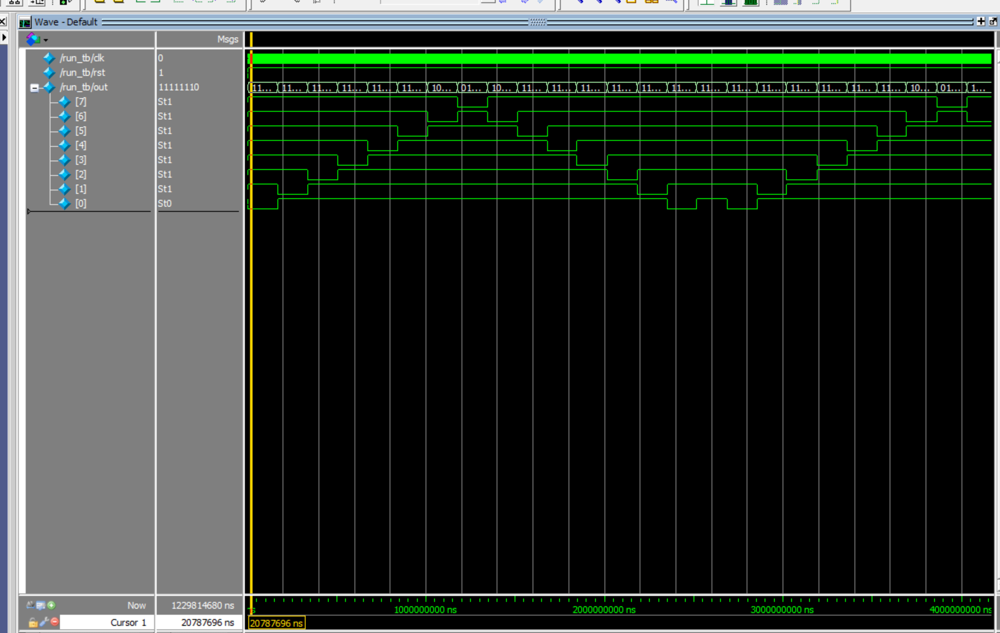

根据波形图,out中始终有一个信号是0,其余为1,而out的值随着时钟周期信号而周期变化,最开始out[0]为0,对应的第一个针脚处的Led灯是熄灭状态,而其他的Led灯为点亮状态,经过时间t之后,out[1]为0,其余为1,对应的第二个针脚处的Led灯熄灭,其他打开,如此往复.从图中可以看到,整个周期是2*8t,一个周期内,LED按照顺序熄灭,然后从头开始,实现了一个跑马灯的效果.
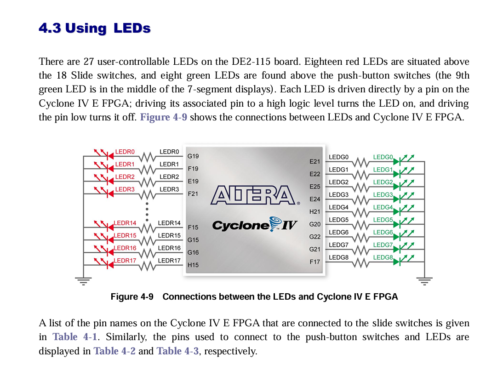
查阅可得,LED灯在信号为1时为点亮状态,反之.

##### (4)RTL图及其分析
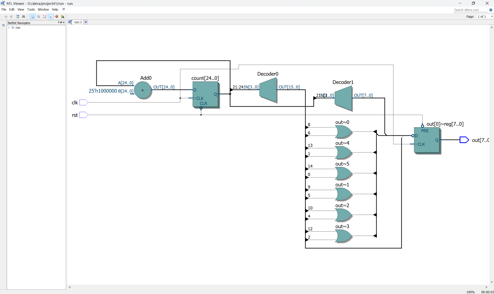
rst是复位信号,负责重置电路状态,连接的是触发器的置位端口,因此可以实现相应的置位功能.count是一个计数器,负责记录是否达到周期.。
1. **LED模式控制**：
`out` 是8位寄存器，负责控制8个LED的状态。当 `rst` 低电平时，`out` 被设置为全亮 (`8'hff`)。根据 `count[24:21]` 的值，决定哪个LED熄灭：从 `8'b1111_1110` 到 `8'b0111_1111`，每次一个LED熄灭。然后按相反顺序重新点亮，形成循环。

2. **模式循环**:`count[24:21]` 控制16个状态，形成完整的跑马灯周期。LED依次熄灭，再依次点亮，形成视觉上的跑马灯效果。
##### (5)FPGA实现过程
1. 首先编写代码,并且通过modelsim的仿真测试,详细参考本例的**1~3**的步骤.
2. 在QuartusⅡ中新建工程,详细参考第三次报告,其中要选择符合要求的型号.即CycloneⅣ E中的EP4CE115F29C7型号,详细见下图.
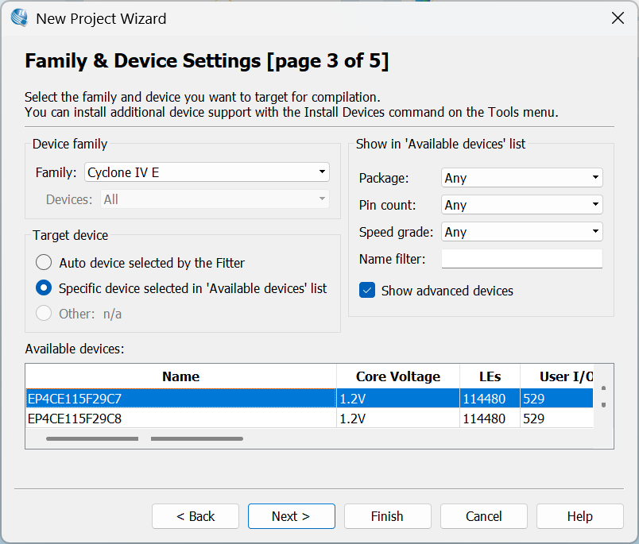
3. 将项目创建完成后进行编译,见下图.
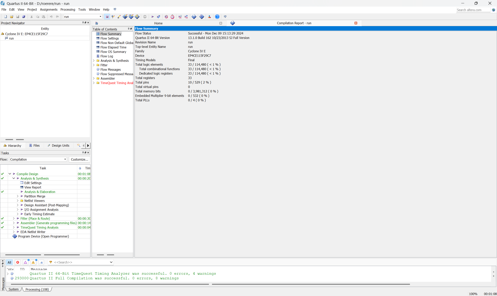
4. 查看电路结构 Tools/Netlist/Viewers/RTL-Viewer.

5. 进行管脚绑定,找到Assignment中的Pin Planner
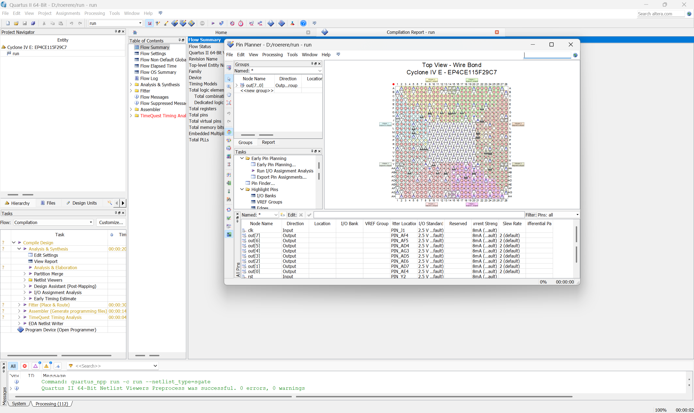
如上图
6. 参考DE2_115 User Manul中的led端口表,复位表和时钟信号表,进行绑定.
**这是绑定结束的表**
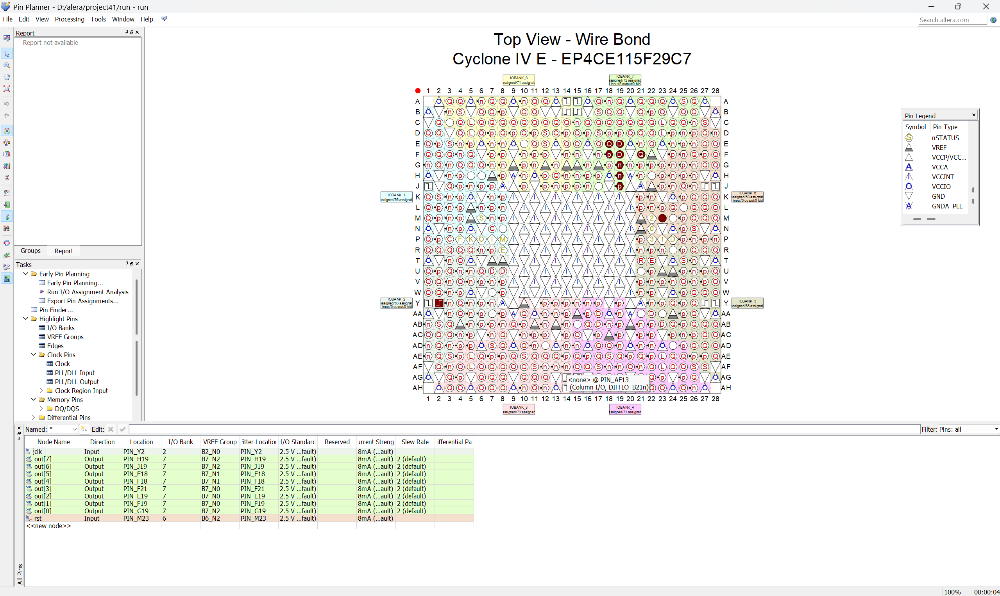
**这是LED的对应表**

**这是复位表**

**这是时钟信号表**

7. 然后在output_files中找到项目对应的.sof文件
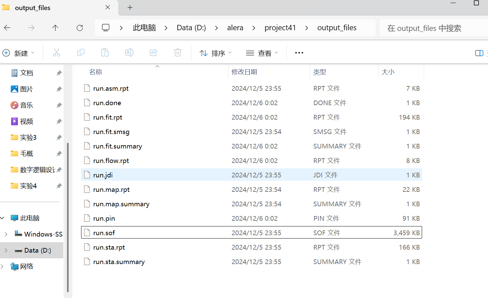

---

### 2.有限状态机设计及仿真（以教材Figure 6.86为例）

##### (0)电路原理分析
这是一个有限状态机,在代码中首先使用parameter进行状态分配,然后依据w,y的取值使用case和if-else进行状态转移即可,最后根据状态输出即可.

##### (1)需求解读
_设计一个带有输入w的,输出z的有限状态机,功能上是一个序列检测器,当w=00或11时,输出z=1,否则为0._
这是状态转移图,依据此图就可以进行代码编写了
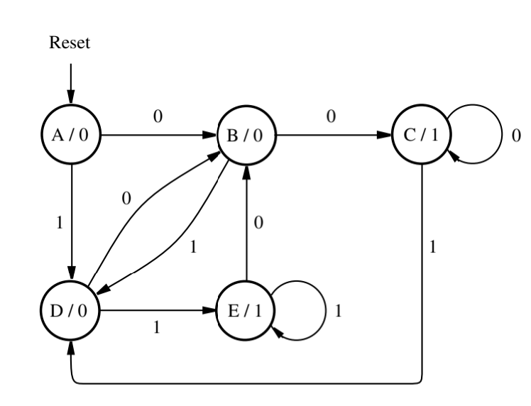
##### (2)模块源码

```verilog
module FSM(CLK, Resetn, w, z);
    input CLK, Resetn, w;
    output z;
    reg [3:1]y, Y;
    parameter [3:1]A = 3'b000, B = 3'b001, C = 3'b010, D = 3'b011, E=3'b100;
    always @(w,y) 
    begin
        case(y)
            A:if(w) Y=D;
            else Y = B;
            B:if(w)Y = D;
            else Y = C;
            C:if(w) Y = D;
            else Y = C;
            D:if(w) Y = E;
            else Y = B;
            E:if(w) Y = E;
            else Y = B;
            default: Y = 3'bxxx;
        endcase
    end
    always @(negedge Resetn, posedge CLK)
        if (!Resetn)
            y <= A;
        else y <= Y;
    assign z = (y ==C ) | (y == E);
endmodule
```

##### (3)测试模块

```verilog
module FSM_tb;
    reg CLK, Resetn, w;
    wire z;
    FSM uut (
        .CLK(CLK),
        .Resetn(Resetn),
        .w(w),
        .z(z)
    );
    
    initial 
    begin
        CLK = 0;
        forever #5 CLK = ~CLK;  // 每5个时间单位切换时钟
    end

    initial
    begin
        // 初始化输入
        Resetn = 0;
        w = 0;
        // 应用复位
        #10 Resetn = 1;
        // 状态测试序列
        #10 w = 0;  // A -> B
        #10 w = 0;  // B -> C
        #10 w = 1;  // C -> D
        #10 w = 1;  // D -> E
        #10 w = 0;  // E -> B
        #10 w = 1;  // B -> D
        #10 w = 0;  // D -> B
        repeat (20) 
        begin
            #20 w = $random % 2;  // 每20个时间单位随机分配w
        end
        // 结束仿真
        #200 $stop;
    end
endmodule
//测试思路是首先通过人为给定的状态转移思路来测试,随后使用随机的方法来继续测试.
```

##### (4)波形图及其分析
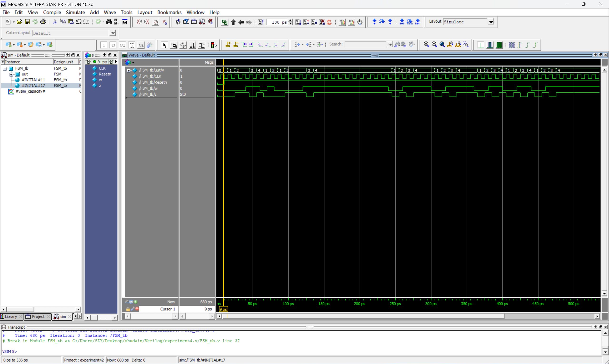
**初始状态（复位）**：
从黄线的位置开始,就是复位结束的地方,当 `Resetn` 为低时，状态机初始化为状态 `A`。

**状态转移序列**：
- **时刻 15ps**：
    - `w = 0`，状态从 `A` 转移到 `B`。
- **时刻 25ps**：
    - `w = 0`，状态从 `B` 转移到 `C`。
- **时刻 45ps**：
    - `w = 1`，状态从 `C` 转移到 `D`。
- **时刻 55ps**：
    - `w = 1`，状态从 `D` 转移到 `E`。
- **时刻 65ps**：
    - `w = 0`，状态从 `E` 转移到 `B`。
- **时刻 75ps**：
    - `w = 1`，状态从 `B` 转移到 `D`。
- **时刻 85ps**：
    - `w = 0`，状态从 `D` 转移到 `B`。

**输出 `z` 的变化**：
   - `z = 1` 当状态为 `C` 或 `E`。
   - 因此，在时刻 25~45ps 和 55~75ps这两个时段，`z` 输出为 1。
以上是在代码中有目的的进行的状态转移,随后是使用随机过程得出的w的输入,经过分析后续过程依旧符合状态转移图,因此该电路的设计是正确的.


##### (5)RTL图及其分析
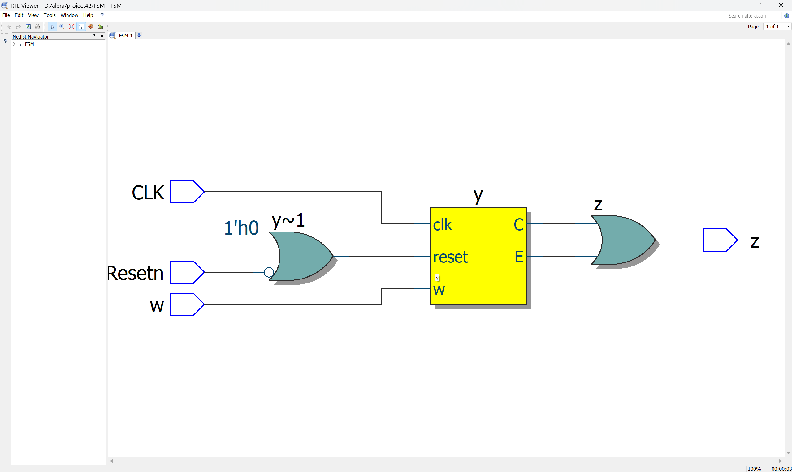
时钟信号CLK和输入信号w,作为FSM的输入,reset接入FSM的端口,z作为该FSM的输出.来实现功能.
这是从QuartusⅡ中导出的状态转移图,与1中的状态转移图是等价的
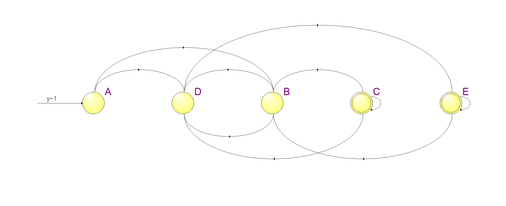
因此可以推断,该状态机的设计是正确的.

##### (6) FPGA
1. 基本过程同上
2. 只是在针脚分配上有所不同,由于不明晰输入的针脚分配,所以就留空,然后将时钟信号和复位信号和上一个实验一样设置,然后将Led灯分配到z上这样当z是高电平的时候灯就会亮起来.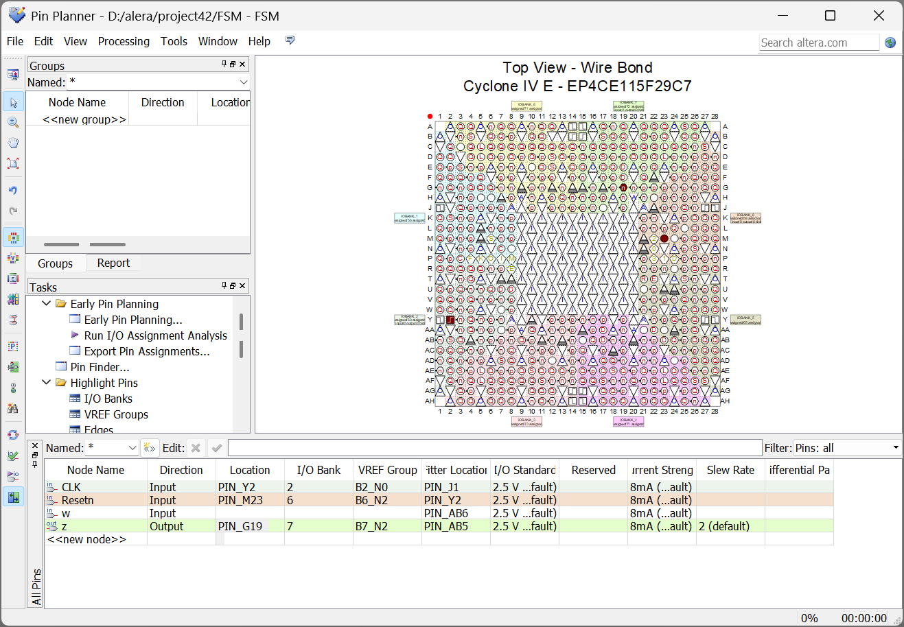


### 六、实验收获与心得
1. 通过跑马灯这个实例,理解了从代码编写,再到测试仿真,再到RTL图仿真,最后到FPGA设计的全流程,全面的理解了面向硬件的设计思维和设计流程.
2. 学习了有限状态机的理论和代码到仿真的全流程,能够依据需求实现从状态转移图到仿真的流程.
3. 从这门课程中,收获了许多东西.首先是对数字逻辑设计这门理论课中学到的东西在实践层面上进行操作,比如测试代码的编写逻辑.
4. 学习了Verilog和数字逻辑设计中的相应的软件的操作.包括modelsim波形仿真工具和QuartusⅡ的仿真工具的使用.
5. 从这门课程当中,我学到了与以往面向软件的编程思维不同的面向硬件的编程思维,深刻的体会了这两种在底层的思维方式的不同,软件的编写不需要考虑时序问题,性能问题的考虑和面向硬件也不相同,面向硬件的编程方式需要时刻考虑硬件实现.


