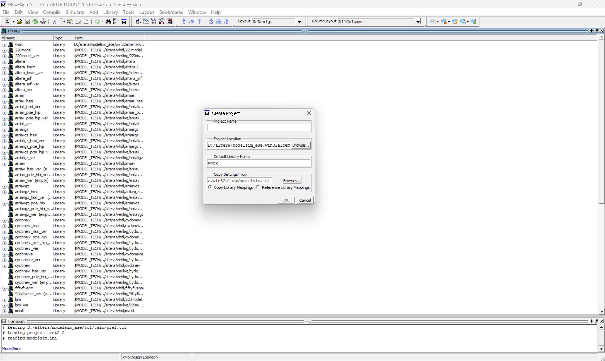
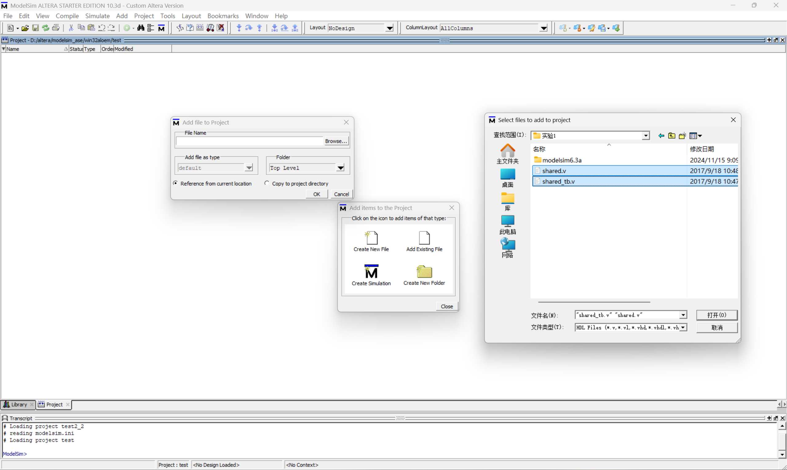
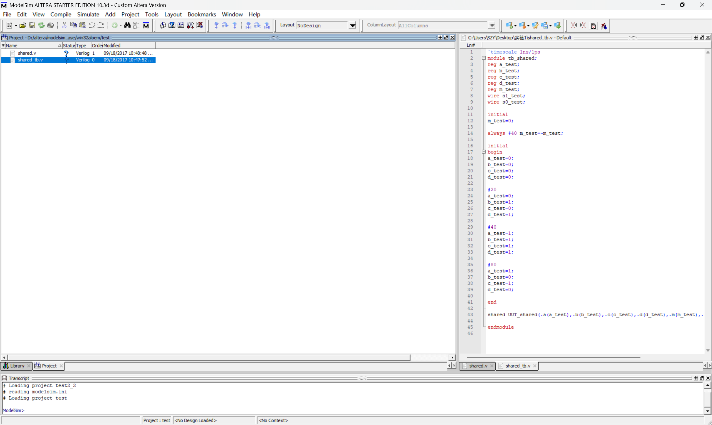
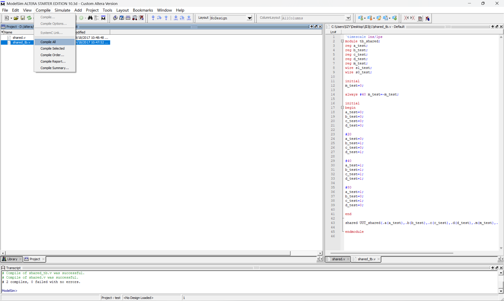
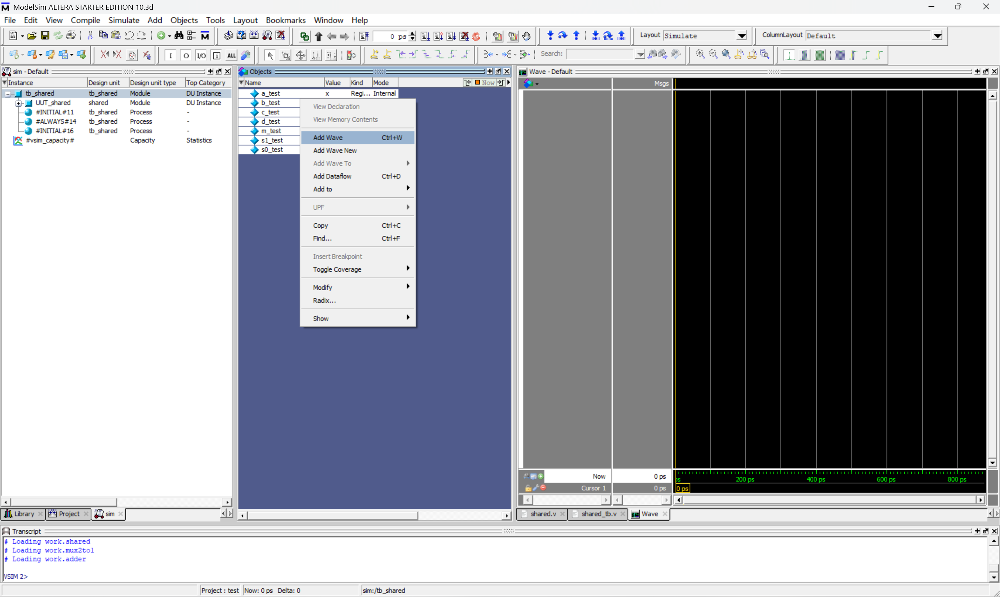
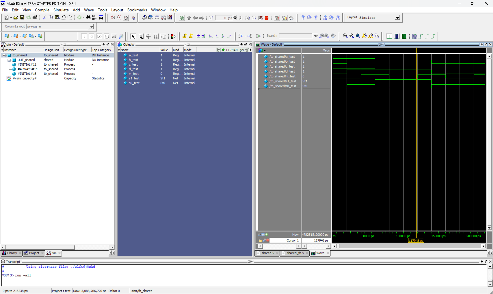
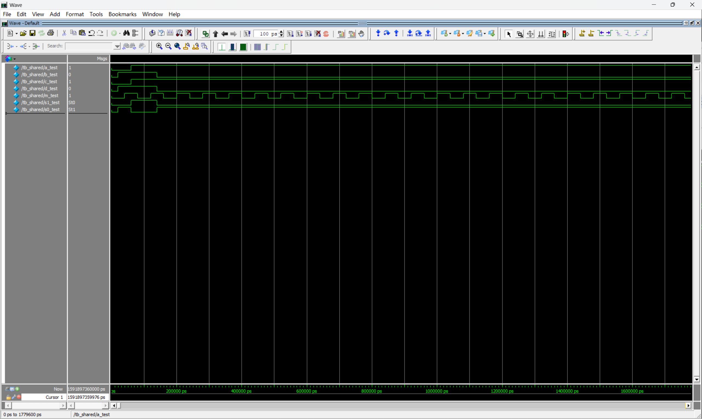
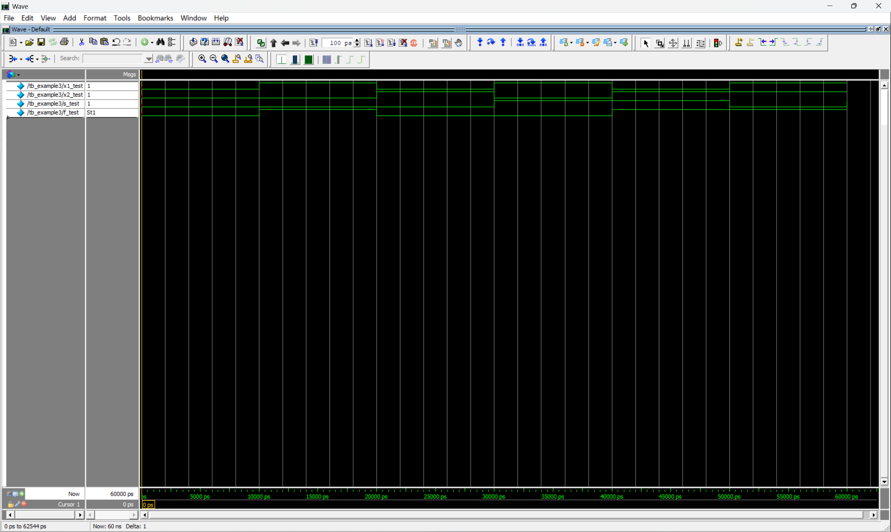
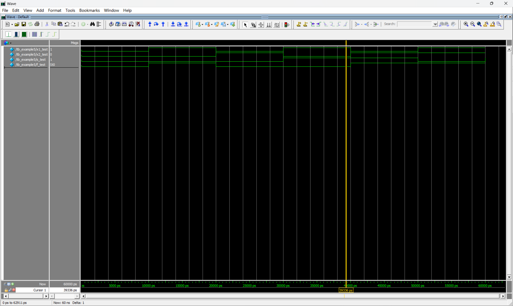
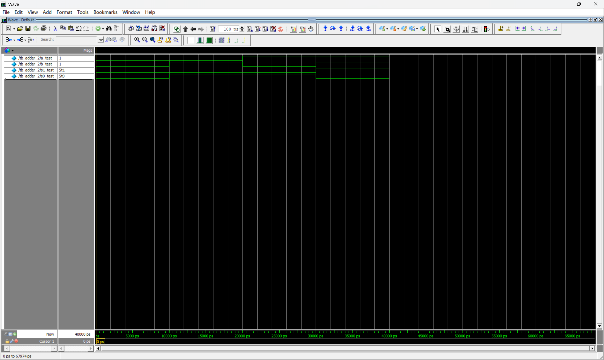

## 实验一	实验环境搭建与数字逻辑正向设计方法

#### 10012303	2023302613	孙镇宇

### 一、实验目的

1. 学习ModelSim的使用方法；

2. Verilog硬件描述语言入门；

3. 初步了解基本组合逻辑电路的设计方法；

4. 学习测试模块（Testbench）的结构和编写方法；

### 二、实验内容

1. 本次实验学习ModelSim仿真工具的安装并学习如何使用。

2. 使用ModelSim工具，使用Verilog HDL语言完成课本Figure2.72，并写出测试模型，对其进行比较全面的测试。

3. 使用ModelSim工具，使用Verilog HDL语言完成课本Figure2.40、Figure2.42电路设计，并编写testbench测试，对比分析测试结果。

4. 使用ModelSim工具，使用Verilog HDL语言完成课本Figure2.45，并编写testbench测试，分析测试结果。

### 三、实验仪器、设备

已安装modelsim的电脑

### 四、实验步骤

1． 建立工程文件，编写模块源码和测试模块,要求测试模块对源文件进行比较全面的测试；

2． 编译源码和测试模块，用测试模块对源文件进行测试，并进行仿真；

### 五、实验内容


#### 1.ModelSim软件使用详细步骤
<br>


**0.安装ModelSim**

点击安装包,选择安装位置.安装完成过后,进入`D:\modelsim_ase\win32aloem\modelsim.exe`即可打开仿真软件.

**1.创建项目**


**2.创建项目文件**

**以figure 2.72为例.**

**3.如何编写代码以及如何进行编译**

1. 编写代码

2. 对代码进行编译



**4.仿真测试**
编译后进行仿真,以及将信号加入到波形图中


仿真得到波形图


---

#### 2.Figure 2.72代码复现及测试模型

**（1）模块源码**

```verilog
module shared (a, b, c, d, m, s1, s0);
	input a, b, c, d, m;
	output s1, s0;
	wire w1, w2;

	mux2to1 U1 (a, c, m, w1);
	mux2to1 U2 (b, d, m, w2);
	adder U3 (w1, w2, s1, s0);
endmodule

module mux2to1 (x1, x2, s, f);
	input x1, x2, s;
	output f;

	assign f = (~s & x1) | (s & x2);
endmodule

module adder (a, b, s1, s0);
	input a, b;
	output s1, s0;

	assign s1 = a & b;
	assign s0 = a ^ b;
endmodule


```

**测试模块**

```verilog
`timescale 1ns/1ps 
module tb_shared;
reg a_test;
reg b_test;
reg c_test;
reg d_test;
reg m_test;
wire s1_test;
wire s0_test;

initial
m_test=0;

always #40 m_test=~m_test;

initial
begin
a_test=0;
b_test=0;
c_test=0;
d_test=0;

#20 
a_test=0;
b_test=1;
c_test=0;
d_test=1;

#40 
a_test=1;
b_test=1;
c_test=1;
d_test=1;

#80 
a_test=1;
b_test=0;
c_test=1;
d_test=0;

end

shared UUT_shared(.a(a_test),.b(b_test),.c(c_test),.d(d_test),.m(m_test),.s1(s1_test),.s0(s0_test));

endmodule

```

这里给出的是由实验二提供的文件进行的测试,这个测试中使用了两种实现测试的方式,第一个是使用周期信号进行测试,第二个就是手工设定经过多少周期之后测试激励的变化.

**（2）仿真波形**



**（3）波形分析**

<!-- 可以看出在testbench中生成的abcd符合cnt各比特位的数据。

以当前时间为112500ps为例，cnt=5，a=0,b=1,c=0,d=1，m_test=1,figure 2.72中，选取a,b进行加法。预测所得数据为s1=1,s0=0，testbench跑出来的结果符合预期。

在一个周期中（共16种情况）波形分析符合预期，故该程序正确。 -->

可以看到生成的各个信号符合设定的生成方式,该模块实现的是一个结构共享的加法器模块,由一个加法器和两个多路选择器构成.以第100000ns为例,可以看到m=1,所以实现的是c+d,最后答案是1,有图可知,st0=1,st1=0,符合电路.同理可得,在有效的仿真时间内,得到的波形都符合预期.故该程序是正确的.

<!-- **（4）Quartus电路图** -->

---

### 3.Figure 2.40、Figure 2.42	Verilog电路设计及分析

**(1)模块源码**

**figure 2.40**

```verilog
module example3(x1,x2,s,f);
    input x1,x2,s;
    output f;

    assign f = (~s & x1) | (s & x2);
endmodule
```

**figure 2.42**
``` verilog

module example5 (x1,x2,s,f);
    input x1,x2,s;
    output f;
    reg f;

    always @(x1 or x2 or s)
        if(s == 0)
            f = x1;
        else
            f = x2;
endmodule
```

**测试模块**

**figure 2.40的测试模块**

```verilog
`timescale 1ns/1ps
module tb_example3;
    reg x1_test;
    reg x2_test;
    reg s_test;
    wire f_test;    

    // 初始化输入信号
    initial begin
        // 初始状态
        x1_test = 0; x2_test = 0; s_test = 0;
        #10 
        x1_test = 1; x2_test = 0; s_test = 0;  
        #10 
        x1_test = 0; x2_test = 1; s_test = 0;  
        #10 
        x1_test = 1; x2_test = 0; s_test = 1; 
        #10 
        x1_test = 0; x2_test = 1; s_test = 1;  
        #10 
        x1_test = 1; x2_test = 1; s_test = 0;  
        #10 
        x1_test = 1; x2_test = 1; s_test = 1;  
    end

    // 实例化被测模块
    example3 UUT_example3(
        .x1(x1_test),
        .x2(x2_test),
        .s(s_test),
        .f(f_test)
    );
endmodule

```

**figure 2.42的测试模块**

```verilog
`timescale 1ns/1ps
module tb_example5;
    reg x1_test;
    reg x2_test;
    reg s_test;
    wire f_test;

    // 初始化输入信号
    initial begin
        // 初始状态
        x1_test = 0; x2_test = 0; s_test = 0;
        #10 
        x1_test = 1; x2_test = 0; s_test = 0;  
        #10 
        x1_test = 0; x2_test = 1; s_test = 0;  
        #10 
        x1_test = 1; x2_test = 0; s_test = 1;  
        #10 
        x1_test = 0; x2_test = 1; s_test = 1;  
        #10 
        x1_test = 1; x2_test = 1; s_test = 0;  
        #10 
        x1_test = 1; x2_test = 1; s_test = 1;  
    end

    // 实例化被测模块
    example5 UUT_example5(
        .x1(x1_test),
        .x2(x2_test),
        .s(s_test),
        .f(f_test)
    );

endmodule


```

**（2）仿真波形**

**figure 2.40**


**figure 2.42**


**(3)波形分析**
<!-- 
figure 2.40和figure 2.42仿真出的波形一样。

该模块都是实现了一个数据选择器的操作。当s=0,f=x1,当s=1,f=x2。

在波形图中，不妨以时间为40100ps时分析，此时x1=0,x2=1,s=1,此时f=1,与我们期待的f=x2=1相符合。波形其余阶段皆满足该性质。故经过testbench测试，这2个module都正确实现了需求。 -->

figure 2.40和figure 2.42仿真出的波形是一致的,这是因为这两段代码都是都同样一个数据选择器的实现,只是实现方式不同而已.不妨以1500ps为例,此时s=0,而f=x1.而在39326ps时,s=1,f=x2
故该程序是正确的.

<!-- **（4）Quartus电路图** -->

---

#### 4.Figure 2.45代码复现及测试模块

**（1）代码源码**

```verilog
module adder_2 (a,b,s1,s0);

    input a,b;
    output s1,s0;

    assign s1 = a&b;
    assign s0 = a^b;
    
endmodule

```

**测试模块**

```verilog
`timescale 1ns/1ps
module tb_adder_2;
    reg a_test;
    reg b_test;
    wire s1_test;
    wire s0_test;

    // 初始化输入信号
    initial begin
        // 测试 00
        a_test = 0; b_test = 0;
        #10;  
        // 测试 01
        a_test = 0; b_test = 1;
        #10;
        a_test = 1; b_test = 0;
        #10;
        a_test = 1; b_test = 1;
        #10;
    end
    adder_2 UUT_adder_2(
        .a(a_test),
        .b(b_test),
        .s1(s1_test),
        .s0(s0_test)
    );

endmodule
```

**（2）仿真波形**



**（3）波形分析**

本模块的实现是一个一位加法器,用于计算a+b的值。
- 若a=0,b=0 --> s1=0,s0=0;
- 若a=0,b=1 --> s1=0,s0=1;
- 若a=1,b=0 --> s1=0,s0=1;
- 若a=1,b=1 --> s1=1,s0=0;
由图可得仿真波形符合预期结果。


### 六、收获心得
- 本次实验中,我了解了ModelSim这个软件的安装和使用的一系列流程,熟悉了从代码编写到仿真测试的全流程.
- 了解了Verilog这门语言,并且使用这门语言对课本的一些电路进行了代码编写与testbench的仿真测试,通过这次实验,我对于课本上的知识的理解更加深入.
- 通过编写了简单的testbench的代码,学习了仿真代码编写的基本知识,如如何设置端口,设置时间,如何设置激励信号.为以后编写更加复杂的代码打下了坚实的基础.
- 利用modelsim这个工具,学习了如何通过仿真波形来判断设计的电路是否能够正确的工作.
