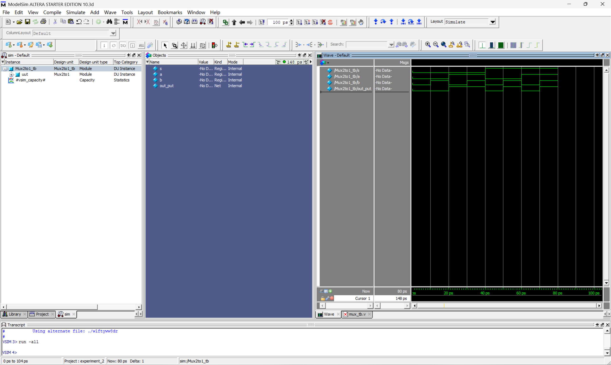
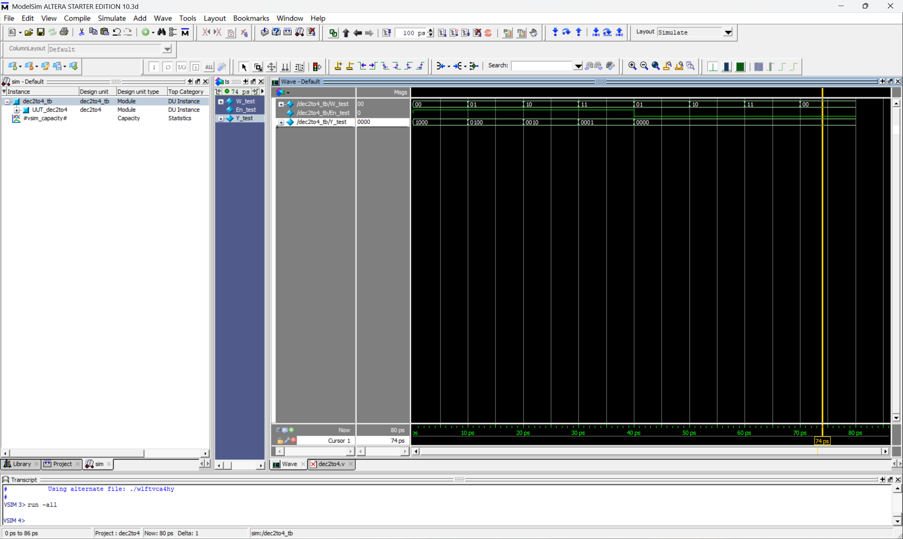
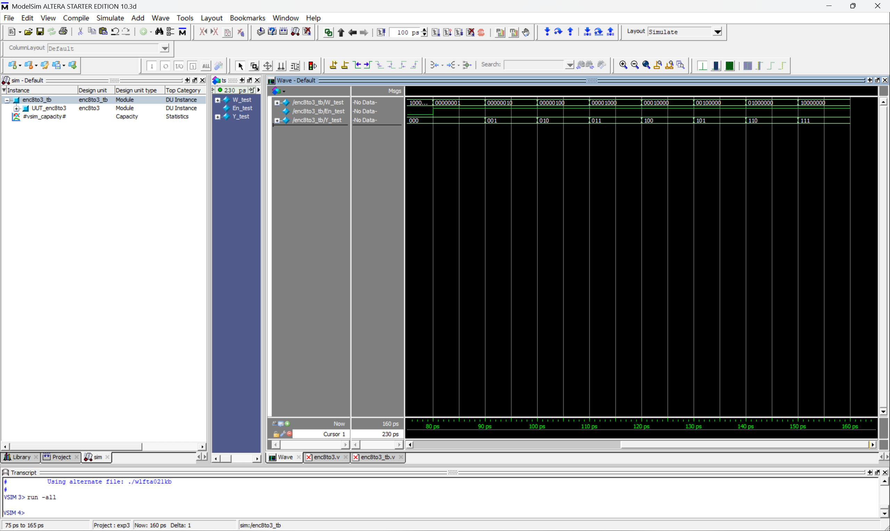
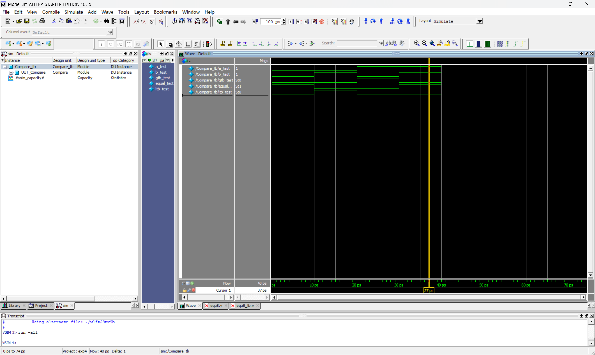
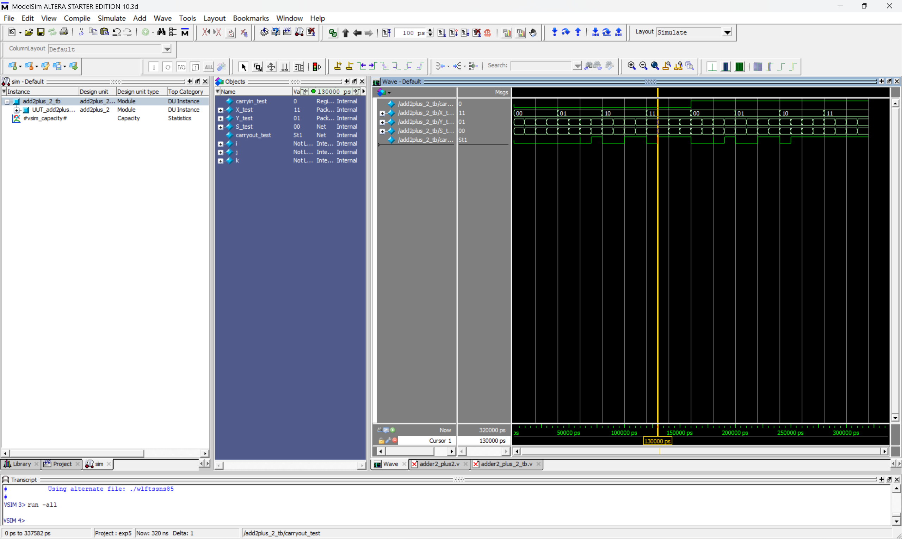

## 实验二	可综合组合逻辑电路实验

#### 10012303	2023302613	孙镇宇

### 一、实验目的

1． 掌握可综合Verilog语言进行组合逻辑设计的使用；

2． 学习测试模块的编写、综合和不同层次的仿真。

### 二、实验内容

1．设计一款可综合的2选1多路选择器，并编写testbench测试

2．设计一款可综合的2-4译码器，并编写testbench测试

3．设计一款可综合的8-3编码器，并编写testbench测试

4．设计一款可综合的1位二进制比较器，并编写testbench测试

5．设计一款可综合的2+2位简单全加器，并编写testbench测试

6．自学verilog编程规范和面向硬件电路的设计思想，小结与高级语言编程的主要区别。

### 三、实验仪器、设备

安装开发工具ModelSim

### 四、实验步骤

1．建立工程文件，编写模块源码和测试模块,要求测试模块能对源文件进行比较全面的测试。

2．编译源码和测试模块，用测试模块对源文件进行测试，并综合仿真。得到波形图。

3．记录数据并完成实验报告。

---

### 五、实验内容

#### 1.可综合的2选1多路选择器

##### (0)电路原理分析
四个输入端口,三个输入,s作为选择信号,a,b作为输入信号,output作为输出信号,使用行为级的描述进行可综合的电路设计.在逻辑门层面使用的是,使用异或门进行.

##### (1)模块源码

```verilog
module Mux2to1 (
    input a,
    input b,
    input s,
    output reg out_put  
);
    always @(*) begin  
        if (s == 0)
            out_put = a;
        else
            out_put = b;
    end
endmodule

```

##### (2)测试模块

```verilog
module Mux2to1_tb;
    reg s, a, b;
    wire out_put;

    Mux2to1 uut (
        .s(s),
        .a(a),
        .b(b),
        .out_put(out_put)
    );

    initial begin
        // Test all combinations of inputs
        s = 0; a = 0; b = 0; #10; // s=0, a=0, b=0
    
        s = 0; a = 0; b = 1; #10; // s=0, a=0, b=1
       
        s = 0; a = 1; b = 0; #10; // s=0, a=1, b=0
       
        s = 0; a = 1; b = 1; #10; // s=0, a=1, b=1
       
        s = 1; a = 0; b = 0; #10; // s=1, a=0, b=0
       
        s = 1; a = 0; b = 1; #10; // s=1, a=0, b=1
       
        s = 1; a = 1; b = 0; #10; // s=1, a=1, b=0
       
        s = 1; a = 1; b = 1; #10; // s=1, a=1, b=1
         
    end
endmodule


```

##### (3)仿真波形



##### (4)波形分析
这是一个二选一的多路选择器当s=0时,output为b从波形上看就是,当s=0时,output的波形与b一致,同时当s=1时,output的波形与a一致.这样就遍历了所有情况,证明仿真与预期功能达到了一致.

##### (5)结论
本实验完成了一个可综合的二选一多路选择器的原理分析,到模块代码和测试代码编写,以及波形仿真测试.

---

#### 2.可综合的2-4译码器

##### (0)电路原理分析
在代码层面使用了矢量的输入,以及利用case语句进行了2-4译码器的情况的枚举,最后进行输出.而在门层面上,利用真值表可以写出每一位的逻辑,进而实现电路.

##### (1)模块源码

```verilog
module dec2to4 (W,En,Y);
    input [1:0]W;
    input En;
    output reg [0:3]Y;

    always@(*)
        case ({En,W})
            3'b100: Y=4'b1000;
            3'b101: Y=4'b0100;
            3'b110: Y=4'b0010;
            3'b111: Y=4'b0001;
            default: Y = 4'b0000;
        endcase
endmodule

```

##### (2)测试模块

```verilog
`timescale 1ps/1ps
module dec2to4_tb;
    reg [1:0]W_test;
    reg En_test;
    wire [0:3]Y_test;

    initial begin

        En_test = 1; W_test = 2'b00; #10; // En = 1，Y 应该为 1000
        En_test = 1; W_test = 2'b01; #10; // En = 1，Y 应该为 0100
        En_test = 1; W_test = 2'b10; #10; // En = 1，Y 应该为 0010
        En_test = 1; W_test = 2'b11; #10; // En = 1，Y 应该为 0001
        En_test = 0; W_test = 2'b01; #10; // En = 0，Y 应该为 0000
        En_test = 0; W_test = 2'b10; #10; // En = 0，Y 应该为 0000
        En_test = 0; W_test = 2'b11; #10; // En = 0，Y 应该为 0000
        En_test = 0; W_test = 2'b00; #10; // En = 0，Y 应该为 0000
    end
    dec2to4 UUT_dec2to4(
        .W(W_test),
        .En(En_test),
        .Y(Y_test)
    );
endmodule

```

##### (3)仿真波形

##### (4)波形分析
这是一个带有使能`En`2to4译码器,可以将二进制的编码转换成one-hot编码,在代码中利用了case进行枚举所有情况.从波形上来看,En=0时,不工作,所以输出为0000.
当En=1时:
```
00 --> 1000
01 --> 0100
10 --> 0010
11 --> 0001
```
综上符合要求,电路正确.

##### (5)结论
本子实验完成了一个可综合的2-4译码器结构,实现了从模块代码到测试代码再到波形仿真的全过程.

---

#### 3.可综合的8-3编码器

##### (0)电路原理分析
同上面的2-4译码器,也采用了矢量的输入,同时由于情况较少,直接采用case语句对所用情况进行了枚举.同时在门层面上的结构,也是采用真值表的方法,对三个输出位分别做出相应的积之和电路.然后进行输出.

##### (1)模块源码

```verilog
module enc8to3(W,En,Y);
    input[7:0]W;
    input En;//高电平有效
    output reg[2:0]Y;
    always@(*)
    begin
      if(!En)
        begin
            Y = 3'b000;
        end
      else 
        begin
            case(W)//枚举W的所有可能情况
                8'b00000001:Y=3'b000;
                8'b00000010:Y=3'b001;
                8'b00000100:Y=3'b010;
                8'b00001000:Y=3'b011;
                8'b00010000:Y=3'b100;
                8'b00100000:Y=3'b101;
                8'b01000000:Y=3'b110;
                8'b10000000:Y=3'b111;
                default:Y=3'b000;
            endcase
      end
    end
 endmodule

```

##### (2)测试模块

```verilog
`timescale 1ps/1ps
module enc8to3_tb;
    reg [7:0]W_test;
    reg En_test;
    wire [2:0]Y_test;

    enc8to3 UUT_enc8to3(
        .W(W_test),
        .En(En_test),
        .Y(Y_test)
    );

    initial begin
        En_test = 0; W_test = 8'b00000001; #10;
        En_test = 0; W_test = 8'b00000010; #10;
        En_test = 0; W_test = 8'b00000100; #10;
        En_test = 0; W_test = 8'b00001000; #10;
        En_test = 0; W_test = 8'b00010000; #10;
        En_test = 0; W_test = 8'b00100000; #10;
        En_test = 0; W_test = 8'b01000000; #10;
        En_test = 0; W_test = 8'b10000000; #10;

        En_test = 1; W_test = 8'b00000001; #10;
        En_test = 1; W_test = 8'b00000010; #10;
        En_test = 1; W_test = 8'b00000100; #10;
        En_test = 1; W_test = 8'b00001000; #10;
        En_test = 1; W_test = 8'b00010000; #10;
        En_test = 1; W_test = 8'b00100000; #10;
        En_test = 1; W_test = 8'b01000000; #10;
        En_test = 1; W_test = 8'b10000000; #10;
    end
endmodule
```
##### (3)仿真波形



##### (4)波形分析
这是一个可综合的8to3编码器,可以将独热编码映射回二进制.同时带有使能开关En,用控制电路的工作与否.代码中使用了case枚举所有情况.在testbench中,也是用了枚举的方式将所有工作状态列举出来.从波形图中可以看到当En=0时,不论输入什么,一律为000.当En=1时,比如01000000就得到了110.对比功能来说是正确的,其他的也同理分析.进而验证了整个电路的正确性.

##### (5)结论
本子实验完成了一个8-3的可综合的编码器.实现了代码编写到波形仿真的全过程.

---

#### 4.可综合的1位二进制比较器

##### (0)电路原理分析
采用了三个标志的输出,即大于等于和小于作为输出.采用行为级的描述,分三种情况进行输出.在逻辑门的层面上,需要定义一系列的中间变量由高到低分别判断每一位是否相等或者大于或者小于.

##### (1)模块源码

```verilog
module Compare(
    input a, // 比较数
    input b, // 比较数
    output reg gtb, // 比较结果
    output reg equal,
    output reg ltb // 比较结果
    );
 
// 行为描述
    always @(*) 
    begin
       if(a==b)
       begin
            equal<=1;
            gtb<=0;
            ltb<=0;
       end
       else if(a < b)
       begin
            equal<=0;
            gtb<=0;
            ltb<=1;
       end
       else
       begin
            equal<=0;
            gtb<=1;
            ltb<=0;
       end
    end

endmodule

```

##### (2)测试模块

```verilog
`timescale 1ps/1ps
module Compare_tb;
    reg a_test;
    reg b_test;
    wire gtb_test, equal_test,ltb_test;

    Compare UUT_Compare(
        .a(a_test),
        .b(b_test),
        .gtb(gtb_test),
        .equal(equal_test),
        .ltb(ltb_test)
    );
    initial
    begin
        a_test = 0 ; b_test = 0; #10;
        a_test = 0 ; b_test = 1; #10;
        a_test = 1 ; b_test = 0; #10;
        a_test = 1 ; b_test = 1; #10;
    end
endmodule

```
##### (3)仿真波形


##### (4)波形分析
这里实现的是一个一位的二进制比较器,模块代码采用了行为级描述,testbench中,由于情况较少所以这里直接对所有情况进行了列举.

**1~10ps:** `a=0,b=0` --> `equal=1,gtb=0,ltb=0`
**10~20ps:** `a=0,b=1` --> `equal=0,gtb=0,ltb=1`
**20~30ps:** `a=1,b=0` --> `equal=0,gtb=1,ltb=0`
**30~40ps:** `a=1,b=1` --> `equal=1,gtb=0,ltb=0`
这是所有出现的情况,经过分析,都是正确的,证明了电路的正确性.

##### (5)结论
本实验完成了一个可综合的一位二进制比较器.使用了行为级的描述语言,以及if else语句进行判断.在testbench代码中,依旧采用穷举所有情况的方式进行仿真.

---

#### 5.可综合的2+2位简单全加器

##### (0)电路原理分析
在模块代码的编写上,使用了分块的结构,首先实现了一个一位的全加器,然后另外定义了一个模块,将两个一位全加器进行了叠加,进而实现了一个2+2的简单全加器.

##### (1)模块源码

```verilog
module fulladder(Cin , x , y, s, Cout);
    input Cin,x,y;
    output reg s, Cout;

    always@(*)
    begin
        s = x ^ y ^ Cin;
        Cout = (x & y) | (x & Cin) | (y & Cin); 
    end

endmodule

module add2plus_2(carryin, X, Y, S, carryout);
    input carryin;
    input [1:0]X,Y;
    output [1:0]S;
    output carryout;
    wire C;

    fulladder stage0 (carryin,X[0],Y[0],S[0],C);
    fulladder stage1 (C,X[1],Y[1],S[1],carryout);
endmodule
```

##### (2)测试模块

```verilog
`timescale 1ns/1ps

module add2plus_2_tb;
    reg carryin_test;
    reg [1:0] X_test, Y_test;
    wire [1:0] S_test;
    wire carryout_test;
    integer i, j, k; // 声明 k 为整型变量
    // 实例化被测试模块
    add2plus_2 UUT_add2plus_2 (
        .carryin(carryin_test),
        .X(X_test),
        .Y(Y_test),
        .S(S_test),
        .carryout(carryout_test)
    );

    initial begin
        
        // 遍历所有可能的输入组合
        for (i = 0; i < 2; i = i + 1) begin
            carryin_test = i;
            for (j = 0; j < 4; j = j + 1) begin
                X_test = j[1:0];
                for (k = 0; k < 4; k = k + 1) begin
                    Y_test = k[1:0];
                    #10; // 等待结果稳定
                end
            end
        end

    end
endmodule

```
##### (3)仿真波形



##### (4)波形分析
这里实现的是一个2+2的全加器,代码中使用了模块化的处理,首先写了一个一位全加器模块,然后进行叠加得到了两位的全加器.在testbench中使用了三个for循环进行枚举得到全部的情况.值得一提的是里面还包括了有Cin的进位的情况.
| 时间 (ps) | carryin_test | X_test | Y_test | S_test | carryout_test |
|-----------|--------------|--------|--------|--------|---------------|
| 0         | 0            | 00     | 00     | 00     | 0             |
| 10,000    | 0            | 00     | 01     | 01     | 0             |
| 20,000    | 0            | 00     | 10     | 10     | 0             |
| 30,000    | 0            | 00     | 11     | 11     | 0             |
| 40,000    | 0            | 01     | 00     | 01     | 0             |
| 50,000    | 0            | 01     | 01     | 10     | 0             |
| 60,000    | 0            | 01     | 10     | 11     | 0             |
| 70,000    | 0            | 01     | 11     | 00     | 1             |
| 80,000    | 0            | 10     | 00     | 10     | 0             |
| 90,000    | 0            | 10     | 01     | 11     | 0             |
| 100,000   | 0            | 10     | 10     | 00     | 1             |
| 110,000   | 0            | 10     | 11     | 01     | 1             |
| 120,000   | 0            | 11     | 00     | 11     | 0             |
| 130,000   | 0            | 11     | 01     | 00     | 1             |
| 140,000   | 0            | 11     | 10     | 01     | 1             |
| 150,000   | 0            | 11     | 11     | 10     | 1             |
| 160,000   | 1            | 00     | 00     | 01     | 0             |
| 170,000   | 1            | 00     | 01     | 10     | 0             |
| 180,000   | 1            | 00     | 10     | 11     | 0             |
| 190,000   | 1            | 00     | 11     | 00     | 1             |
| 200,000   | 1            | 01     | 00     | 10     | 0             |
| 210,000   | 1            | 01     | 01     | 11     | 0             |
| 220,000   | 1            | 01     | 10     | 00     | 1             |
| 230,000   | 1            | 01     | 11     | 01     | 1             |
| 240,000   | 1            | 10     | 00     | 11     | 0             |
| 250,000   | 1            | 10     | 01     | 00     | 1             |
| 260,000   | 1            | 10     | 10     | 01     | 1             |
| 270,000   | 1            | 10     | 11     | 10     | 1             |
| 280,000   | 1            | 11     | 00     | 00     | 1             |
| 290,000   | 1            | 11     | 01     | 01     | 1             |
| 300,000   | 1            | 11     | 10     | 10     | 1             |
| 310,000   | 1            | 11     | 11     | 11     | 1             |

这是波形中的所有情况,经过判断是正确的.

##### (5)结论
在代码编写上,使用了一位全加器进行叠加实现了2+2的全加器,在测试代码的编写上,使用了三个for循环来穷举所有变量,让编写更加简单.经过仿真测试后,可以验证这个电路是正确的.

---

### 六、自学verilog编程规范和面向硬件电路的设计思想，小结与高级语言编程的主要区别。

#### Verilog编写规范
1. **命名规则**
   - 使用有意义的名称,名称不能以数字开头,不能连续使用下划线,不能包含非字母符号.
   - 参数,常量,块标号一致采用大写,信号变量和结构名以及实例标号一致使用小写,有助于区分
   - 名称具有唯一性,且区分大小写
   - | 命名   | 信号类型        |
        | ------ | --------------- |
        | *_r    | 寄存器类型      |
        | *_a    | 异步信号        |
        | *_clk  | 时钟信号        |
        | *_nc   | 不连续信号      |
        | *_n    | 低电平有效信号  |
        | *_pn   | 有n个相位的信号 |
        | *_z    | 三态信号        |
        | *_next | 状态机信号      |
        | *_test | 测试模式信号    |

        这里是常用的命名习惯,还有一些后缀的优先级.
    - 模块命名规则,将模块英文名称的各个单词的首字母组合起来，形成3～5个符号的缩写。所有的变量命名分为两个部分：第一部分表明数据方向，其中数据发出方在前，数据接收方在后；第二部分为数据名称。两个部分用下划线隔离开。第一部分全部大写，第二部分中所有具有明确意义的英文名全部拼写或者缩写的第一个字母大写，其余部分小写.模块内部的信号由几个单词连接而成，缩写要求能基本表明本单词的含义
    
2. **注释**
   - 注释通常包括:公司信息，文件信息，创建信息，修改信息等。在模块和程序文档中,也应该有良好的注释.
3. **代码格式**
   - 必须明确的表明端口类型,每行只有一个端口
   - 在一个区域中申明所有的内部连线
   - 控制代码缩进形式
   - 每行只有一个Verilog语句,保证每行不超过80个字符.
   - 避免使用硬编码数值

#### 面向硬件电路的设计思维
1. 阻塞赋值与非阻塞赋值
    - 对组合逻辑建模采用阻塞赋值
    - 对时序逻辑建模采用非阻塞赋值
    - 用多个always块分别对组合和时序逻辑建模
    - 尽量不要在一个always块里面混合使用阻塞赋值和非阻塞赋值。如果在同一个块即为组合逻辑又为时序逻辑，应使用“非阻塞赋值”
2. 程序的并行执行特点
3. 程序的可综合性
   - Verilog代码的程序可综合性指的是代码能够被综合工具转换为实际的硬件电路，这意味着代码不仅能在仿真环境中正确工作，还需要在综合为硬件之后进行工作.在面向硬件的设计思维中，编写可综合的Verilog代码对硬件实现的深刻理解，并在编写代码时始终考虑到代码将如何被转换为实际的硬件电路。
4. 面积和速度的转换
   - 两者往往不可兼得,需要根据实际需要进行考虑.
5. 同步电路的设计原则
   - 避免毛刺的影响,简化时序分析过程,减少工作环境对设计的影响.
   - 单时钟设计,设计中尽量使用单一的全局时钟.
   - 避免门控时钟,禁止在模块内部使用计数器分频产生所需的时钟.
6. 模块划分的设计原则
   - 信息隐蔽,抽象原则,保证高内聚低耦合.设计功能明确而不重复的模块,避免让信号跨越不同时钟域,尽量进行资源复用.
7. 通用的代码风格
   - 逻辑复用,避免意外的锁存器,如果想利用if语句来实现那些对延时要求苛刻的路径，应将最高优先级给最迟到达的关键信号。有时为了兼顾面积和速度，可以将if和case语句合用。

#### 与高级语言的不同
- 首先需要具备硬件设计思维,与高级语言脱离硬件不同的是,verilog是需要被综合成硬件的.
- 其次是并行的设计思维,与高级语言不同的是,硬件程序设计要时刻考虑程序并行.
- 对于if-else和for循环的使用频率,在高级语言中这很常用,但是在硬件设计语言中,就需要考虑for循环和if-else带来的一系列综合过程中带来的问题.
   
   


### 七、收获和心得
<!-- 1.这次实验中我实现了多路选择器、译码器、编码器、二进制比较器、2位+2位简单全加器，对Verilog的基本语法更加熟悉，能够自己手动编写基本的模块。

2.在编写testbench中，我使用了random的方法，简化了代码编写。

3.我自学了Verilog的编程规范与面向硬件电路的设计思想，总结了面向硬件电路设计思想与高级语言编程的主要区别。 -->

1. 本次实验中,我实现了多路选择器,译码器,编码器,一位二进制比较器,2+2的全加器,对于课本中的组合逻辑的理解更加深刻,同时练习了Verilog的语法.理解了向量变量的易用性.
2. 在testbench的编写过程中,学习了使用一些高级的过程控制来对测试分支的枚举,有效的减少了测试代码编写的工作量.
3. 了解了Verilog的代码编写规范以及面向硬件的程序设计思维,对比高级语言,总结了两者的多种不同点.

