## 实验三	可综合时序逻辑电路实验

#### 10012303	2023302613	孙镇宇

### 一、实验目的

1． 掌握可综合Verilog语言进行时序逻辑设计的使用；

2． 学习测试模块的编写、综合和不同层次的仿真。

### 二、实验要求

1．设计一款时钟上升沿触发的D寄存器,并编写testbench.

2．设计一款4bBit具有并行加载功能的移位寄存器,并编写testbench

3．设计一款4 bit带复位功能的计数器,并编写testbench和仿真波形,请包括以下测试点:电路是否能复位? 是否能按预期增加计数? 是否按预定溢出?

4．如何设计一个定时器,(如：时钟频率20M,定时为1秒)并编写testbench（在第3题的基础上完成）

5．串并转换器设计与仿真(可选作)

### 三、实验设备：

安装开发工具ModelSim、Quartus的PC

### 四、实验步骤

1．建立工程文件，编写模块源码和测试模块,要求测试模块能对源文件进行比较全面的测试。

2．编译源码和测试模块，用测试模块对源文件进行测试，并综合仿真。得到波形图。

3．记录数据并完成实验报告。

4.使用QuartusII软件的RTL viewer工具查看/确认所设计的电路。

### 五、实验内容

#### 1.时钟上升沿触发的D寄存器

##### (0)电路原理分析
利用非阻塞赋值和always模块对于clk的上升沿的把控,当上升沿来临的时候如果不在置位状态就让输出Q=D,在电路层面使用D触发器实现.
##### (1)模块源码

```verilog
module D_register(reset,clk,D,Q);
    input reset,clk,D;
    output reg Q;

    always@(posedge clk)
    begin
      if(!reset)
        Q<=0;
      else 
        Q<=D;
    end
endmodule
```

##### (2)测试模块

```verilog
`timescale 1ps/1ps

module D_register_tb;
    reg reset, clk, D;
    wire Q;

    D_register uut (
        .reset(reset),
        .clk(clk),
        .D(D),
        .Q(Q)
    );
    initial begin
        clk = 0;
        reset = 0;
        D = 0;
    
        #5 reset = 1; // Release reset
        #10 D = 1; // Set D high
        #10 D = 0; // Set D low
        #10 reset = 0; // Assert reset
        #5 reset = 1; 
        #10 D = 1; 
        #5 reset = 0;
    
    end
    
    always #5 clk = ~clk; 
endmodule

```

##### (3)波形图及其分析
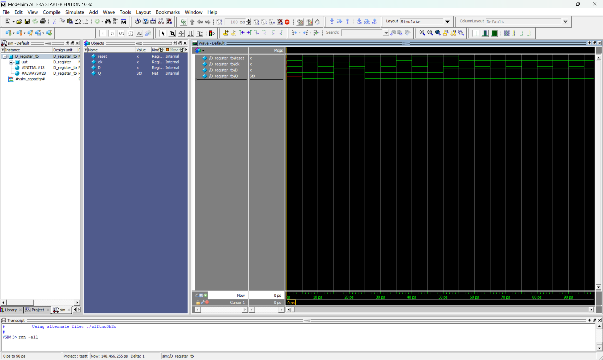
由图可知,当reset为0时,无论时钟上升沿来临时,D是什么状态,Q都取零.当reset=1,时当时钟上升沿来临,Q=D,比如图中第55ps时.再比如50ps时当D改变,但是为到时钟上升沿的时候Q保持不变.说明在未来到时钟上升沿的时候,Q会保持之前的数值,由波形图可得知,模块设计是正确的.

##### (4)RTL图及其分析
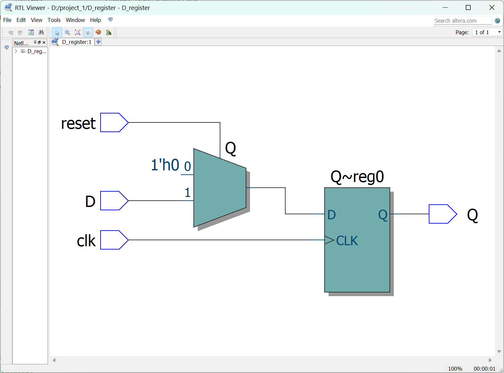
源代码中,复位信号reset在RTL中作为了一个多路选择器的选择信号,若reset=0,输入信号一直为0,当reset=1时选择D作为D触发器的输入,实现了置位功能.多路选择器的输出打到D触发器上,当时钟上升沿来到的时候,Q就会收到输入值.
##### (5)结论
经过波形图仿真和RTL仿真,可以确定该模块的设计是正确的.

---

#### 2. 4 bit具有并行加载功能的移位寄存器

##### (0)电路原理分析
模块名为 `shiftrne`，其核心功能是在时钟上升沿根据控制信号 `L` 决定寄存器 `Q` 的行为。当 `L` 为高电平，加载R,在L为低电平的时候,寄存器Q右移一位.利用L作为判断条件,使用if-else语句进行选择.使用for循环实现右移一位的功能.在电路层面,该模块实现为一组触发器构成的移位寄存器，外加一个多路选择器用于决定是在时钟上升沿时加载新数据还是执行移位操作。多路选择器根据 `L` 的状态选择 `R` 或移位后的值作为新的寄存器内容，从而实现并行加载或移位的功能。
##### (1)模块源码

```verilog
module shiftrne (R, L, w, Clock, Q);
    parameter n = 4;
    input [n-1:0] R;
    input L, w, Clock;
    output reg [n-1:0] Q;
    integer k;

    always @(posedge Clock) 
    begin
        if (L)
            Q <= R;
        else
        begin
            Q[n-1] <= w;
            for (k = n-2; k >= 0; k = k-1)
                Q[k] <= Q[k+1];
        end    
    end
endmodule

```

##### (2)测试模块

```verilog
`timescale 1ps/1ps
module shiftrne_tb;
    reg [3:0] R;
    reg L, w, Clock;
    wire [3:0] Q;
    
    // 实例化 shiftrne 模块
    shiftrne uut (
        .R(R),
        .L(L),
        .w(w),
        .Clock(Clock),
        .Q(Q)
    );
    
    initial begin
        Clock = 0;
        R = 4'b0000;
        L = 0;
        w = 0;
        // 测试并行加载
        #5 R = 4'b1010; L = 1; // 加载 R 到 Q
        #10 L = 0; // 停止加载
        
        // 测试右移
        #10 w = 1; // 移入 1
        #10 w = 0; // 移入 0
        #10 w = 1; // 移入 1
        #10 w = 0; // 移入 0
        
        // 再次测试并行加载
        #10 R = 4'b1100; L = 1; // 加载新 R 到 Q
        #10 L = 0; // 停止加载
        
        // 继续移位
        #10 w = 1; // 移入 1
        #10 w = 1; // 移入 1
    end
    
    // 时钟生成器
    always #5 Clock = ~Clock; // 每5个时间单位翻转时钟
endmodule


```

##### (3)波形图及其分析
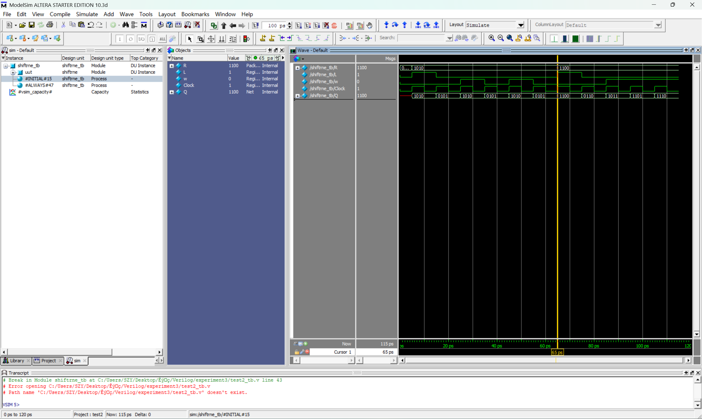
在波形一开始,L=0数据还未进行载入.R的初始值为`1010`,在L=1之后,在第5~15ps中,可以看到Q=1010,说明加载功能是正确的.在加载之后L=0,禁用加载功能.随后在第15ps时,w=0,当时钟上升沿来到后Q=0101说明模块将w右移进入其中.说明右移功能时正常的.在65ps时又使用了1100进行加载,同时进行右移验证.
- **w=0 Q: 1100 --> 0110**
- **w=1 Q: 0110 --> 1011**
- **w=1 Q: 1011 --> 1101**

综上可得,4 bit具有并行加载功能的移位寄存器的加载功能和移位功能都是正确的,所以这个模块的设计也是正确的.

##### (4)Quartus生成的RTL图
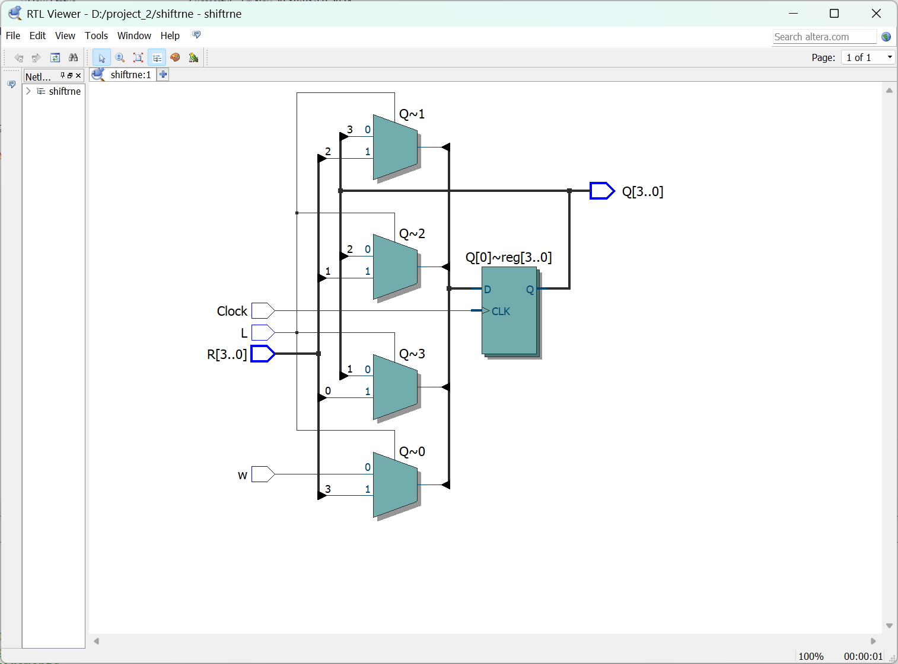
利用L作为多路选择器的控制信号,其中多路选择器一段连接的时输入R,另外一段时w以及上一个寄存器的输出,当L=1时统一将R作为D触发器的输入,当时钟上升沿来到的时候,数据得到加载.当L=0时,开始进行移位功能,会接受w作为输入,同时将触发器的输出向下一位触发器输入,实现移位功能.此RTL图满足需求.
##### (5)结论
通过波形图和综合出的RTL图可得,该模块的设计时正确的.

---

#### 3. 4 bit带复位功能的计数器

##### (0)电路原理分析
在代码实现层面,使用的都是非阻塞赋值,当Reset为1时,Q恒为0实现置位功能,当时钟上升沿来到且Reset为0时,Q=Q+1,实现了计数功能.同时设置了一个E的使能信号,只有当E是高电平的时候,计数器才能够正常加1.在综合电路层面,使用了D触发器和一个加法器实现.
##### (1)模块源码

```verilog
module upcount (Reset, Clk, E, Q);
    input Reset, Clk, E;
    output reg [3:0]Q;

    always @(posedge Reset, posedge Clk) 
    begin
        if(Reset)
            Q <= 0;
        else if(E)
            Q <= Q+1;    
    end
endmodule
```

##### (2)测试模块

```verilog
`timescale 1ps/1ps
module upcount_tb;
    reg Reset, Clk, E;
    wire [3:0] Q;

    upcount uut (
        .Reset(Reset),
        .Clk(Clk),
        .E(E),
        .Q(Q)
    );
    
    initial begin
        // 初始化信号
        Clk = 0;
        Reset = 0;
        E = 0;
        
        // 激活复位
        #5 Reset = 1;
        #10 Reset = 0; // 释放复位
        
        //观察完整计数周期和溢出
        #10 E = 1;
        #200; // 让计数器走完整个周期
        
        // 在计数到一半时测试复位
        #10 Reset = 1;
        #10 Reset = 0; // 释放复位
        
        // 重新计数
        #10 E = 1;
        #80; // 继续计数
        
    end 
    always #5 Clk = ~Clk; // 每5个时间单位翻转时钟
endmodule

```

##### (3)波形图及其分析
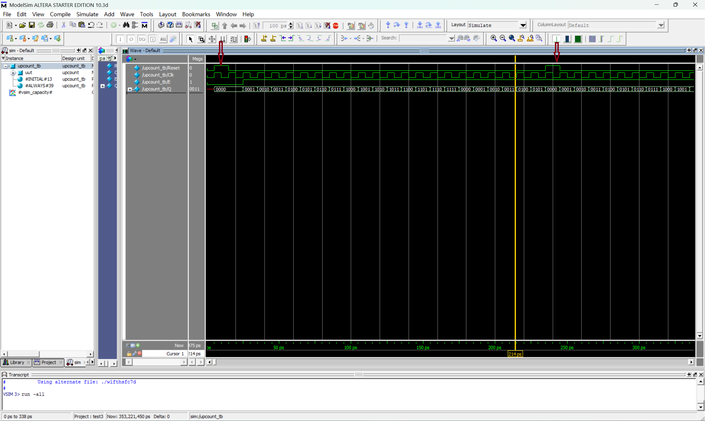
从波形图上看,在第一个箭头处,reset为低电平,模块被初始化为0,然后E放开,计数器开始进行计时,可以看到溢出功能也是正常的.在第二个箭头处,得到了一次reset信号,可以看到,计数器被立即重置,然后继续计时.由此可见计数器模块的功能是正常的.
testbench完成了电路初始化测试,E使能功能测试,计数器功能测试,计数器溢出测试,计数器复位测试,均符合预期.

##### (4)RTL图及其分析
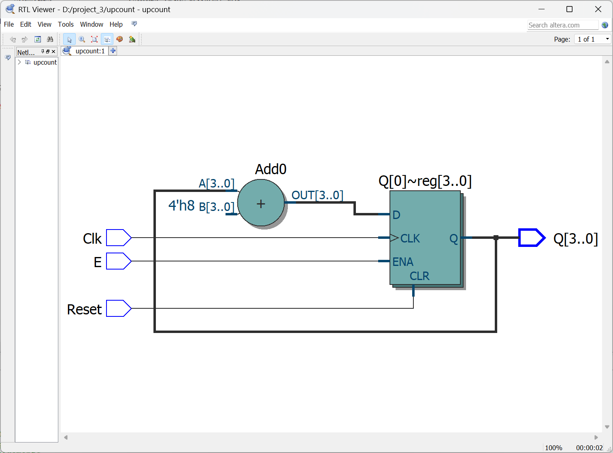
RTL图中,reset为高电平时,触发D触发器的置位,因此输出为0.即cnt=0,符合功能.当Reset为低电平时,开始进行计数,通过D触发器的输出和一个加法器进行相加,得到新的D触发器的输入,如此往复实现计数即Q=Q+1的功能.RTL图说明模块的设计是正确的.
##### (5)结论
通过波形仿真和RTL综合电路图的分析,可以认为该模块的设计是正确的.

---

#### 4.定时器

##### (0)电路原理分析
在代码层面上,使用reset作为异步复位信号,若reset=0,就将s_cnt和clk_cnt同时置0,当电路开始工作时,每一个时钟周期会让clk_cnt+1,当到达设定值的时候clk_cnt置0,s_cnt加1,代表已经过去了1s.在代码中使用的时1KHz的时钟周期信号,主要是为了在testbench的编写过程中以及观察波形的时候会方便一些.
##### (1)模块源码

```verilog
module dtime_cnt (
    input reset,        
    input clk,            
    output reg [2:0] s_cnt
);
    reg [9:0] clk_cnt;   // 缩小为 10 位计数器，用于仿真（计数 1,000 个时钟周期）

    initial clk_cnt = 0;

    always @(posedge clk or negedge reset) 
    begin
        if (!reset) 
        begin
            // 异步复位：清零秒计数器和时钟计数器
            s_cnt <= 0;
            clk_cnt <= 0;
        end 
        else 
        begin
            // 正常计数逻辑
            if (clk_cnt == 1_000 - 1) // 仿真时设置为 1,000 个时钟周期
            begin
                // 1 秒钟到达时
                s_cnt <= (s_cnt == 7) ? 0 : s_cnt + 1; // 3 位计数器溢出时回到 0
                clk_cnt <= 0; // 重置时钟计数器
            end 
            else 
            begin
                // 时钟计数器递增
                clk_cnt <= clk_cnt + 1;
            end
        end
    end
endmodule

```

##### (2)测试模块

```verilog
`timescale 1ms/1ms  // 使用毫秒级时间单位

module tb_time_cnt;
    reg clk;
    reg reset;
    wire [2:0] s_cnt;

    time_cnt uut (
        .reset(reset),
        .clk(clk),
        .s_cnt(s_cnt)
    );

    // 时钟生成：周期为 1ms（频率为 1kHz）
    always #0.5 clk = ~clk;
    initial begin
        // 初始化信号
        clk = 0;
        reset = 0;

        // 仿真步骤
        #1 reset = 1;          // 释放复位信号
        wait (s_cnt == 2);     // 等待秒计数器到达 2
        #1 reset = 0;          // 触发复位信号
        #2 reset = 1;          // 释放复位信号
        #10;                   // 继续观察溢出行为
        $stop;                 // 停止仿真
    end
endmodule

```

##### (3)波形图及其分析
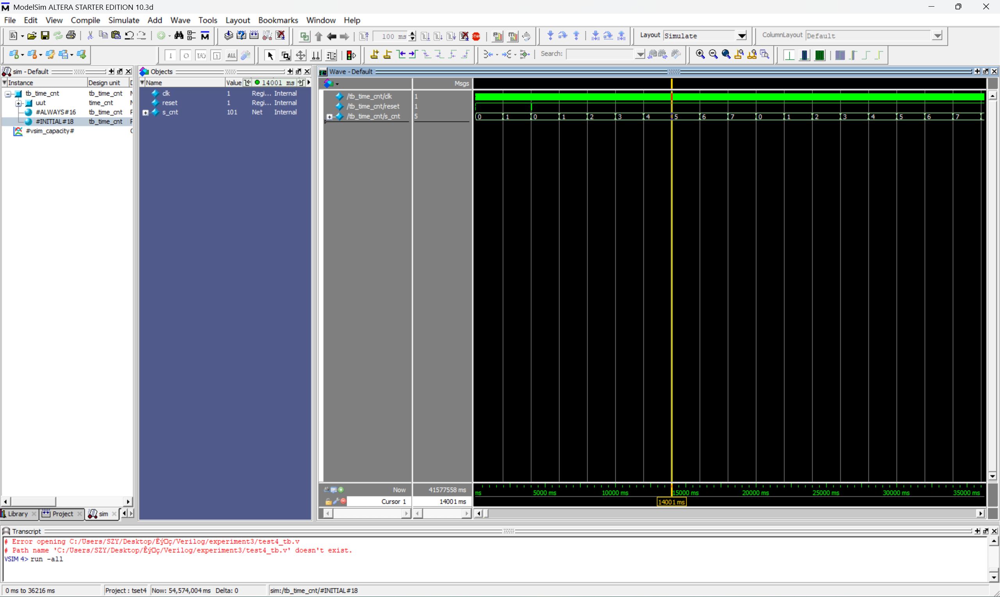
可以看到当开始计数后,当计数到1时触发了一次置位,直接将计数重置.当计数到7的时候,又从零开始说明溢出功能时正常.由上述分析可知,该定时器的功能时正常的,复位功能,溢出功能和计数功能均符合要求.
##### (4)RTL图及其分析
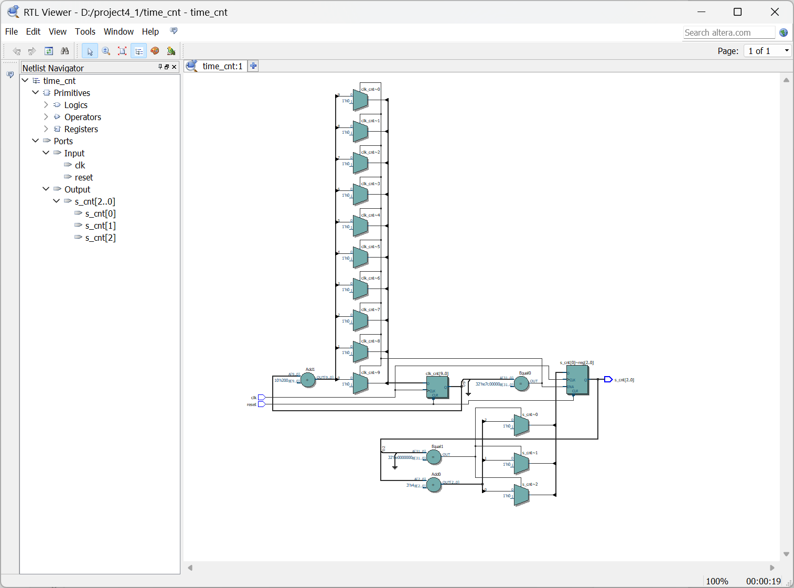
- **触发器**: 
   `clk_cnt` 和 `s_cnt` 均由触发器实现，分别对应 10 位和 3 位寄存器。
- **加法器**: 
   一个加法器用于 `clk_cnt` 的递增，另一个加法器用于 `s_cnt` 的递增。
- **比较器**: 
   比较器用于检测 `clk_cnt` 是否达到 1000，以及 `s_cnt` 是否达到 7。
- **复位逻辑**: 
   `reset` 信号通过复位端口直接控制触发器的清零操作。
##### (5)结论
通过对波形和综合出的电路图进行分析,该模块的编写是正确的.

---

### 六、Quartus II 使用基本步骤
以给出的shared.v文件为例.
1. 首先打开软件然后点击files,再点击新建项目.

2. 然后点击next,找项目文件夹以及给出项目的名字(需要与module中的名字一致)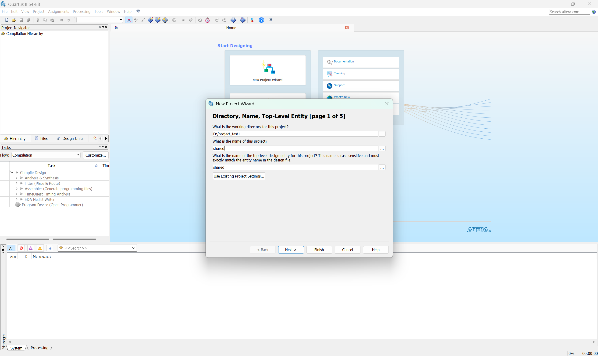
3. 将需要进行综合的电路添加到项目中(注意路径中不能有中文)
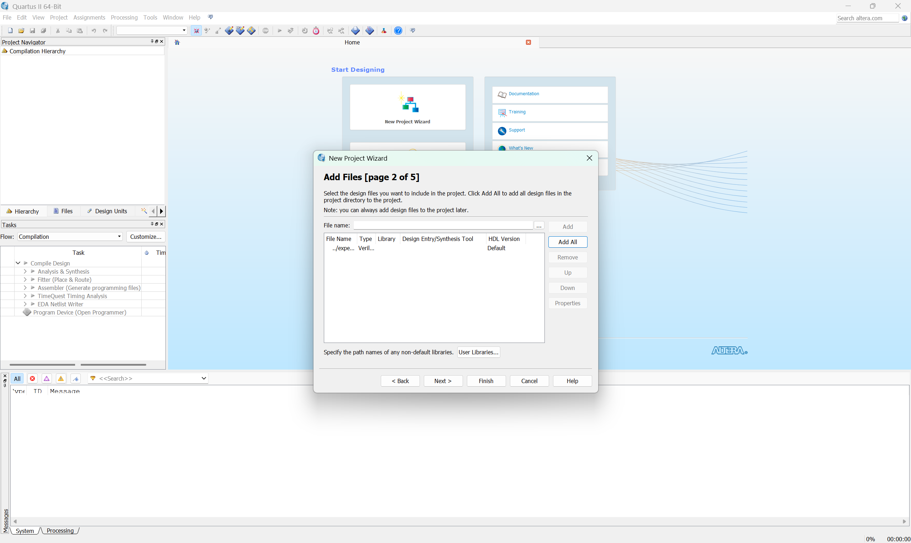
4. 进行单片机型号选择,以及一系列设置.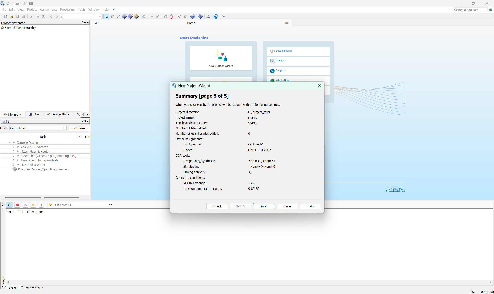
5. 进入项目后,点击编译,等待编译完成.
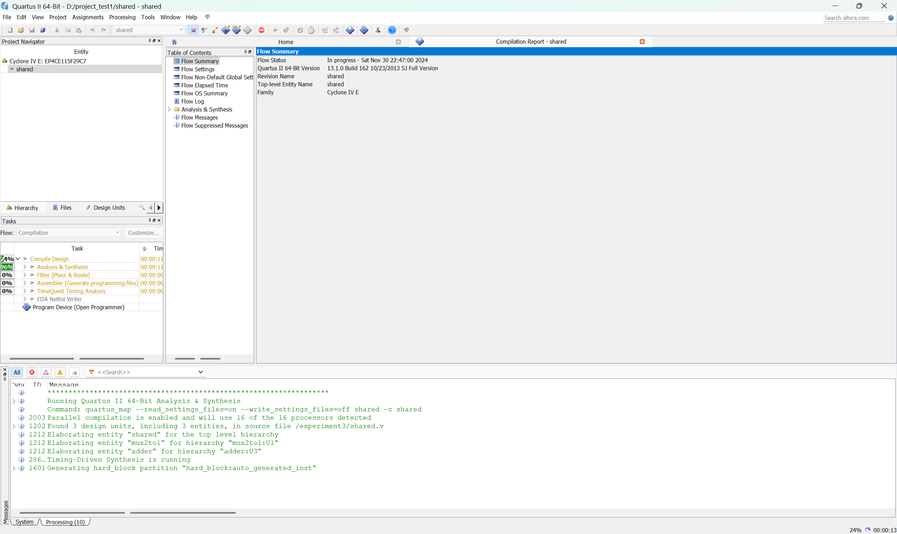
6. 编译完成后,图中位置找到RTL viewer
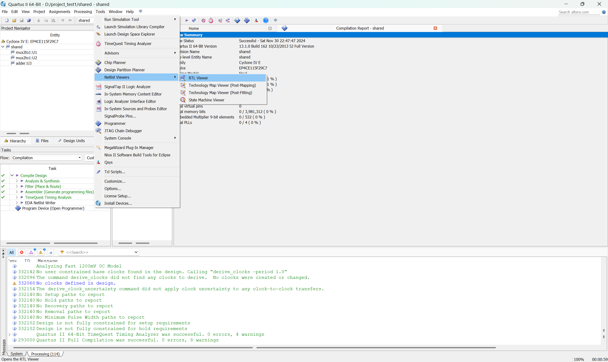
7. 最后得到RTL图
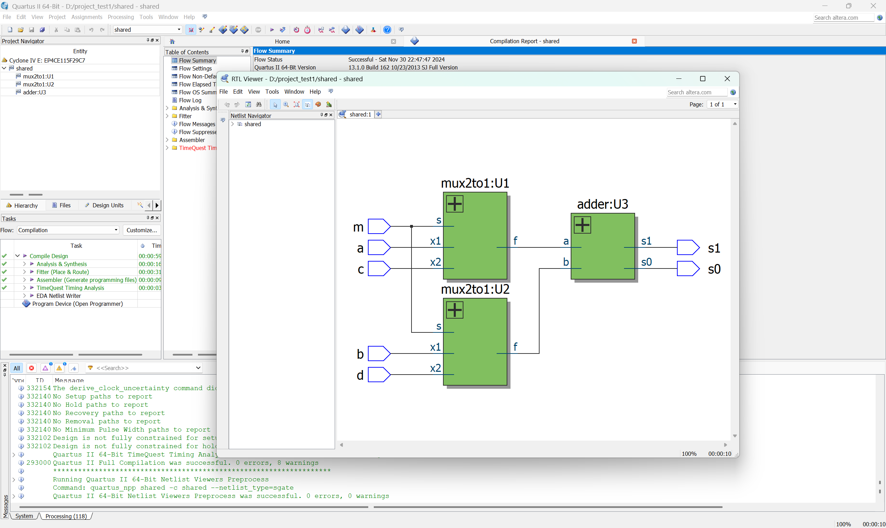
### 七、实验收获与心得
1. 实践了课本中第五章讲的时序逻辑电路,实现了寄存器,D触发器,计数器等基本原件,同时对时钟信号和使能信号以及同步和异步有了更加深刻的理解.
2. 对于时序电路的testbench的编写更加熟悉.了解了基本时间单位和时钟周期之间的关系.
3. 对于综合电路这个过程有了更加深刻的理解,同时加深了自己对于面向硬件的设计语言和思想的理解.
4. 学习了QuartusⅡ软件的使用,能够将编写的Verilog代码转换成实际的电路.

